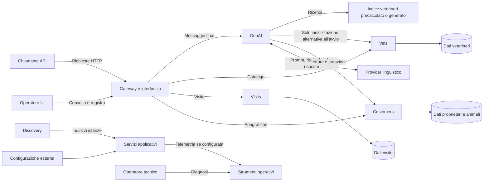
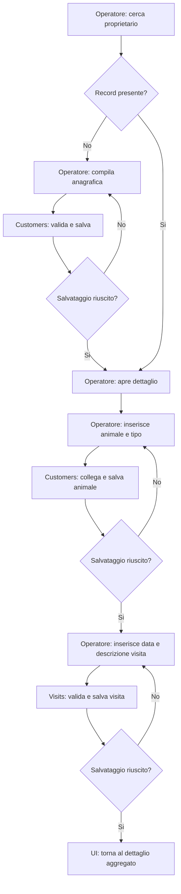
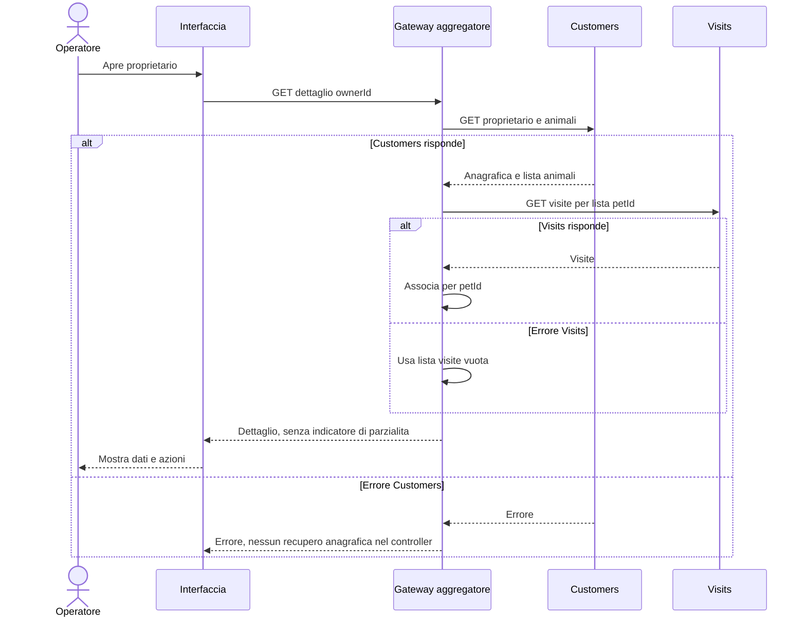
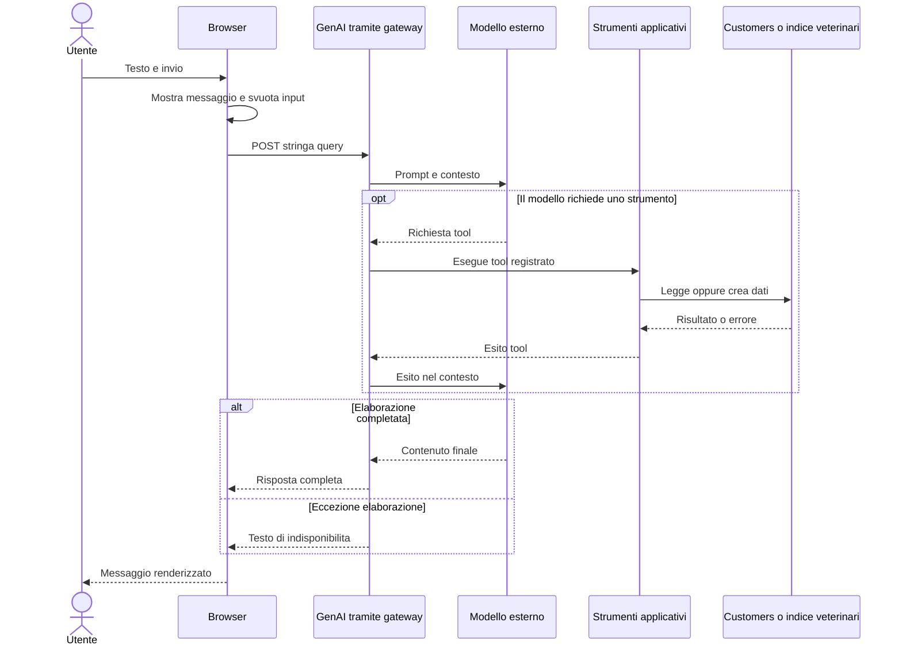
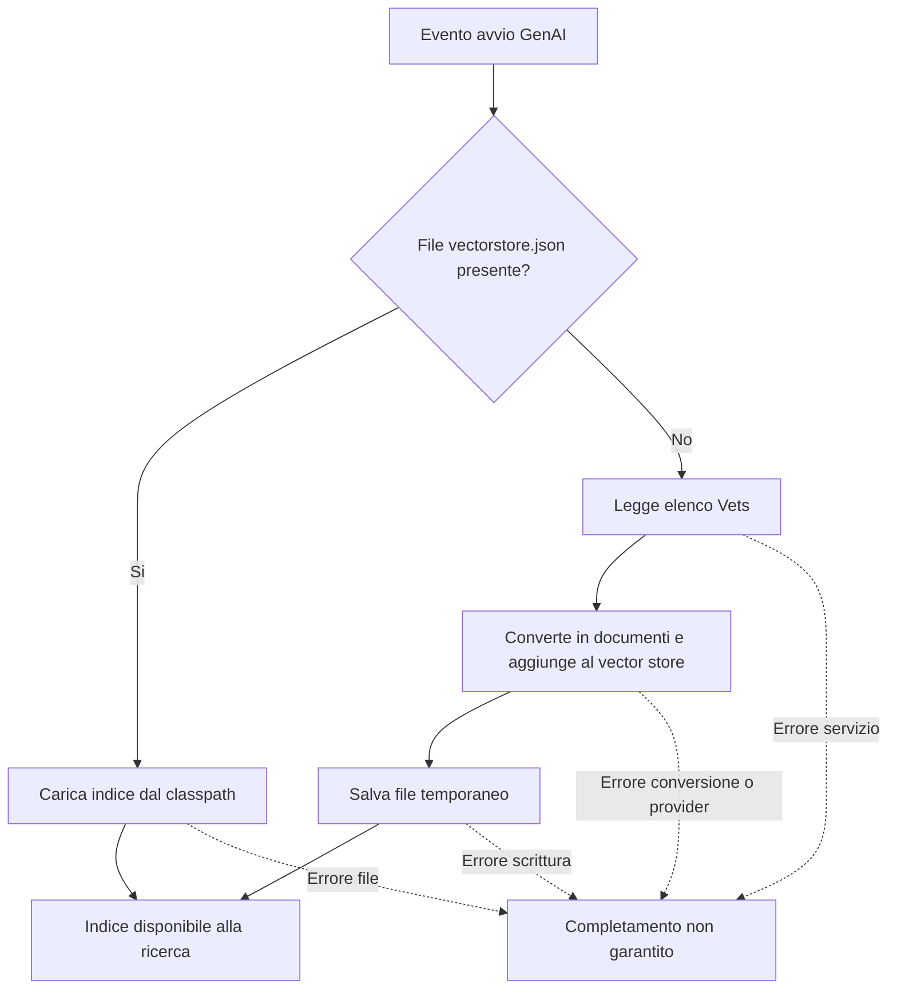
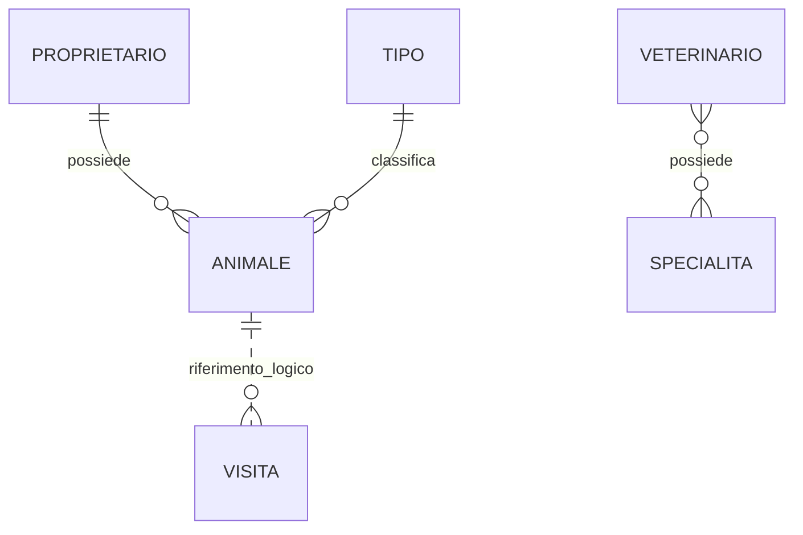

# Processi completi e dati di business

[Torna all'indice](README.md). I diagrammi rappresentano collegamenti verificati nel sorgente; i servizi non sono stati avviati. Riferimenti E-xx in [verifica](verifica.md).

## D-01 — Contesto (F-01–F-09)

Le frecce indicano finalità degli scambi; i contenitori dati indicano responsabilità logiche, non garantiscono database fisicamente separati in ogni profilo. Configurazione/discovery si applicano ai servizi pertinenti; non sono tappe manuali di ogni visita. Fonti E-01, E-03–E-11.

## P-01 — Dalla registrazione alla prima visita (F-01–F-05)

L'operatore cerca prima il proprietario per evitare una duplicazione manuale, ma il sistema non impone questa verifica. Può registrare il proprietario, aprirne il dettaglio, aggiungere un animale e infine annotare una visita. Ogni invio è una richiesta e un salvataggio distinti. Se l'ultimo fallisce, i dati creati prima restano: non c'è una transazione unica, compensazione o annullamento dell'intero percorso. Non sono previsti approvazione, assegnazione al veterinario o invio di notifiche nel flusso analizzato.

### D-02 — Responsabilità ed errori di registrazione

Le frecce di correzione descrivono un nuovo tentativo manuale, non un retry automatico né una garanzia sul comportamento dell'interceptor. Alla riapertura controllare l'eventuale salvataggio già avvenuto. Fonti E-02–E-06; regole R-02–R-07. Esito: dati registrati senza cambio di uno stato clinico.

## P-02 — Dettaglio e risultato parziale (F-04)

### D-03 — Sequenza di lettura

È una catena richiesta/risposta HTTP. L'uso di client reattivi non dimostra un processo di business asincrono con coda o callback. Il fallback Visits è coperto da un test con client simulato, non da una prova di indisponibilità reale. E-05, E-12; R-05.

## P-03 — Richiesta in chat con possibile scrittura (F-07)

### D-04 — Sequenza di conversazione

Lo schema mostra il possibile ciclo tool, non un numero garantito di invocazioni. Nessun callback utente o approvazione intermedia è implementato; il browser attende con una promessa, senza streaming. L'esito di una creazione è verificabile rileggendo Customers, non dal solo testo del modello. E-08, E-09; R-09, R-10.

### D-05 — Preparazione indice (F-08)

Non è una schedulazione periodica; non c'è ripresa applicativa codificata. Il file temporaneo non sostituisce automaticamente la risorsa classpath al riavvio. Fonti E-10; R-11.

## Modello concettuale e ciclo di vita

| Entità | Significato e campi | Vita del dato nel perimetro esposto |
|---|---|---|
| Proprietario | ID, nome, cognome, indirizzo, città, telefono | Creato e modificabile; contiene zero o più animali. Nessuna archiviazione/eliminazione via UI/API dedicata |
| Animale | ID, nome, nascita, tipo, proprietario | Creato sotto un proprietario; nome/data/tipo modificabili. Trasferimento, morte, cancellazione non modellati |
| Tipo animale | ID e nome | Consultabile per scegliere il tipo; nessuna manutenzione UI/API rilevata |
| Visita | ID, petId, data, descrizione | Creata e letta; nessuno stato, veterinario assegnato, durata o storico revisioni. Nessuna operazione dedicata di modifica/annullamento |
| Veterinario | ID, nome e cognome, specialità | Catalogo letto dall'applicazione; caricamenti demo non sono una gestione utente |
| Specialità | ID e nome | Associata a più veterinari; nessuna gestione UI/API rilevata |
| Conversazione visibile | Messaggi HTML del browser | Ripristino da localStorage; distinta dalla memoria del modello e dai dati clinici |
| Documento vettoriale | Rappresentazione del veterinario per similarità | Caricato/generato all'avvio; nessuna sincronizzazione continua verificata |

### D-06 — Relazioni di dominio

E-03, E-04, E-06, E-07: Customers e i relativi schemi richiedono un proprietario e un tipo per animale. La relazione tratteggiata visita–animale descrive il significato del petId: **non garantisce** che ogni visita abbia un animale esistente in ogni profilo. HSQLDB non ha la FK fra visite e animali; lo script MySQL richiede una tabella `pets` nello stesso database. Le specialità sono molti-a-molti nel modello Vet. Non c'è relazione verificata fra visita e veterinario.

Non è incluso un diagramma di stati clinici: le entità non hanno un campo di stato o transizioni di approvazione, scadenza, chiusura e riapertura. Creazione e aggiornamento sono operazioni sui dati, non stati di business da inventare. La persistenza al riavvio dipende da datasource e inizializzazione; gli script HSQLDB contengono DROP, quelli MySQL usano CREATE IF NOT EXISTS. Non sono politiche di conservazione o procedure di backup.
